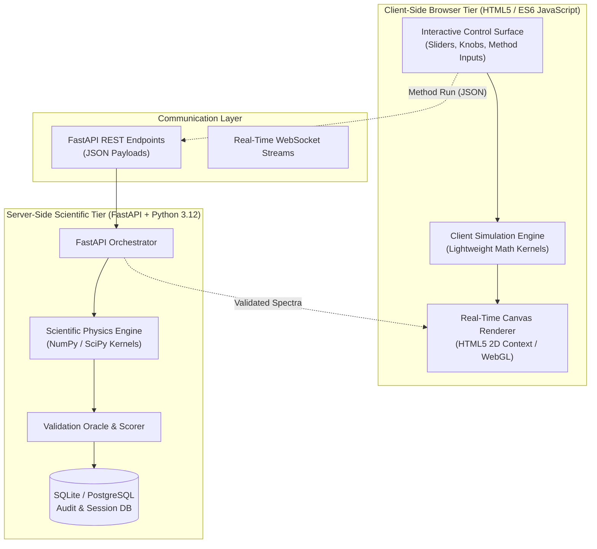

# SimuPharm System Architecture & Engineering Specification

## 1. Architectural Philosophy

SimuPharm is engineered as an **Isomorphic Dual-Simulation Platform**. Analytical pharmaceutical instruments require two distinct operational modalities:
1. **Ultra-Low Latency Interactivity (Client-Side Tier):** Students adjusting a flow rate or column temperature slider must observe instant chromatographic and spectral changes without perceptible lag (>60 FPS, <16 ms response time).
2. **Deterministic Scientific Precision & Assessment (Server-Side Tier):** Assessment grading, automated teacher feedback, and research comparisons require rigorous, reproducible floating-point calculations with scientific library backends (NumPy, SciPy).

---

## 2. Component Architecture

---

## 3. Instrument Engine Specifications

### 3.1 HPLC Simulation Pipeline (`hplc.py` & `hplc_simulator_script.js`)
- **Input Parameters:** Mobile phase composition (% organic B), flow rate ($F$ in mL/min), column length ($L$ in cm), particle diameter ($d_p$ in µm), column diameter ($d_c$ in mm), temperature ($T$ in °C), injection volume ($V_{inj}$ in µL).
- **Physical Kernels:**
  1. *Linear Velocity:* $u = \frac{4 F}{\pi d_c^2 \epsilon_{total}}$
  2. *Van Deemter Height:* $H = 2 \lambda d_p + \frac{2 \gamma D_m}{u} + (C_s + C_m) u$
  3. *Plate Count:* $N = \frac{L}{H}$
  4. *Capacity Factor Retention:* $k' = k'_0 \exp\left(-\frac{\Delta H^\circ}{R T}\right) \cdot \frac{1 - \phi_B}{\phi_{ref}}$
  5. *Peak Profile Generation:* Bi-Gaussian asymmetric peak convolution with exponential tailing.
- **Output:** Multi-compound time-signal vector, USP tailing factor, resolution ($R_s$), number of theoretical plates ($N$).

### 3.2 UV-Vis Spectroscopy Engine (`uvvis.py` & `uv_vis_script.js`)
- **Input Parameters:** Compound library selection, molar concentration ($c$ in mol/L), cuvette path length ($l$ in cm), spectral range ($\lambda_{min} - \lambda_{max}$), photometric noise parameter ($\sigma_{noise}$).
- **Physical Kernels:**
  1. *Beer-Lambert Core:* $A_{peak} = \epsilon \cdot c \cdot l$
  2. *Gaussian Band Broadening:* $A(\lambda) = \sum A_i \exp\left(-\frac{(\lambda - \lambda_i)^2}{2 \sigma_i^2}\right)$
  3. *Noise Injection:* $A_{measured}(\lambda) = \max(0, A(\lambda) + \mathcal{N}(0, \sigma^2))$
  4. *Transmittance Conversion:* $T(\%) = 10^{-A} \times 100\%$
  5. *Calibration Regression:* OLS slope, intercept, $R^2$, LOD ($3.3 \sigma / S$), LOQ ($10 \sigma / S$).

### 3.3 FTIR Spectroscopy Engine (`ftir.py` & `ftir_script.js`)
- **Input Parameters:** Sample selection, ATR crystal type (Diamond, ZnSe, Ge), scan count ($n_{scans}$), resolution ($\Delta\bar{\nu}$ in cm⁻¹).
- **Physical Kernels:**
  1. *Interferogram Retardation Sampling:* Optical path difference $\delta = 2 x$.
  2. *Fourier Transformation:* Discrete FFT transforming interferogram to transmission spectrum.
  3. *ATR Depth of Penetration:* $d_p = \frac{\lambda}{2 \pi n_1 \sqrt{\sin^2\theta - (n_2/n_1)^2}}$

---

## 4. Data Security & Intellectual Property Protection

SimuPharm separates publicly documentable physics equations from proprietary assets:
1. **Public Physical Principles:** Fundamental equations (Van Deemter, Beer-Lambert, Biot, Stokes-Einstein, Golay) are universally established academic physical laws.
2. **Proprietary Elements Protected:** Proprietary empirical tuning constants, institutional scoring rubrics, commercial client databases, and billing/credential infrastructures are strictly decoupled and never committed to public repositories.
